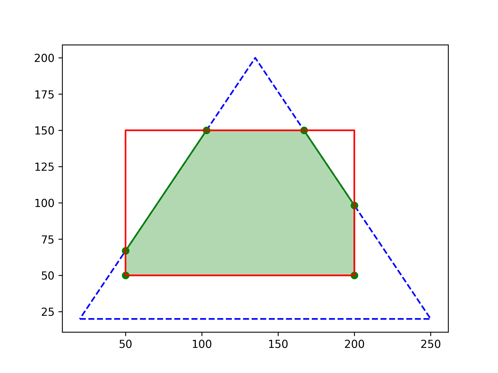

# Polygon Clipping Using the Sutherland-Hodgman Algorithm

This project implements polygon clipping using the Sutherland-Hodgman algorithm. A polygon is clipped against a rectangular window one boundary at a time.

## Clipping Window

The fixed clipping window is defined by:

- **X minimum:** `50`
- **X maximum:** `200`
- **Y minimum:** `50`
- **Y maximum:** `150`

## Input Polygon

The polygon vertices used for this implementation are:

```text
(20, 20)
(250, 20)
(135, 200)
```

The boundaries are processed in the following order:

1. Left
2. Right
3. Bottom
4. Top

## Requirements

- Python 3
- `matplotlib`

Install the required package with:

```bash
pip install matplotlib
```

## How to Run

Run the program from the project directory:

```bash
python polygon_clipping_201.py
```

Enter `3` when prompted for the number of vertices, then enter each vertex:

```text
20 20
250 20
135 200
```

## Output

### Image Output

The original polygon is shown as a blue dashed outline, the clipping window is shown in red, and the clipped polygon is shown in green.



### Text Output

```
The Clipping window: from (50,50) to (200,150)

Enter the number of vertices of the polygon: 3
Enter x-coordinate of vertex 1: 20
Enter y-coordinate of vertex 1: 20
Enter x-coordinate of vertex 2: 250
Enter y-coordinate of vertex 2: 20
Enter x-coordinate of vertex 3: 135 
Enter y-coordinate of vertex 3: 200

The vertices of the original polygon are: 
(20, 20)
(250, 20)
(135, 200)
(20, 20)

The vertices of the polygon after clipping at Left boundary are: 
(50, 20.0)
(250, 20)
(135, 200)
(50, 66.95652173913044)

The vertices of the polygon after clipping at Right boundary are: 
(50, 20.0)
(200, 20.0)
(200, 98.26086956521739)
(135, 200)
(50, 66.95652173913044)

The vertices of the polygon after clipping at Bottom boundary are: 
(50.0, 50)
(200.0, 50)
(200, 98.26086956521739)
(135, 200)
(50, 66.95652173913044)

The vertices of the polygon after clipping at Top boundary are: 
(50.0, 50)
(200.0, 50)
(200, 98.26086956521739)
(166.94444444444446, 150)
(103.05555555555556, 150)
(50, 66.95652173913044)

The vertices of the clipped polygon are: 
(50.0, 50)
(200.0, 50)
(200, 98.26086956521739)
(166.94444444444446, 150)
(103.05555555555556, 150)
(50, 66.95652173913044)

```
