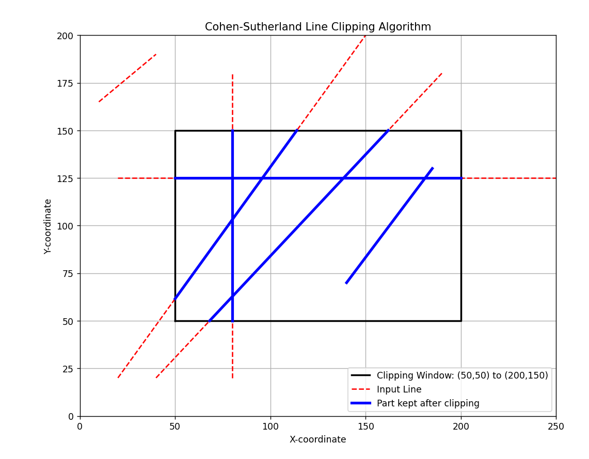

# Cohen–Sutherland Line Clipping Algorithm

A Python implementation of the **Cohen–Sutherland Line Clipping Algorithm** using explicit 4-bit region codes and bitwise operations. The program clips a given line segment against a predefined rectangular clipping window and visualizes the result using Matplotlib.

## Overview

In Computer Graphics, line clipping is the process of removing portions of a line that lie outside a specified viewing area.

The Cohen–Sutherland algorithm is a classical line clipping algorithm that uses region codes to determine whether a line segment should be:

- **Trivially Accepted:** Both endpoints lie inside the clipping window.
- **Trivially Rejected:** Both endpoints lie outside a common boundary.
- **Clipped:** The line intersects one or more boundaries of the clipping window.

This project implements the algorithm from scratch in Python without using any built-in or library-based clipping functions.

## Features

- Implements the Cohen–Sutherland line clipping algorithm.
- Uses explicit 4-bit region codes.
- Uses bitwise AND (`&`) and OR (`|`) operations for acceptance and rejection decisions.
- Supports keyboard input for a single line segment.
- Uses a fixed rectangular clipping window.
- Handles zero-length, vertical, and horizontal lines.
- Validates input coordinates and clipping window boundaries.
- Displays the original line and clipped portion using Matplotlib.
- Displays the clipping status and resulting endpoints in the console.

## Clipping Window

The clipping window extends from `(50,50)` to `(200,150)`.

## Region Codes

Each endpoint is assigned a 4-bit region code based on its position relative to the clipping window.

| Bit | Flag   | Condition | Meaning |
| --- | ------ | --------- | ------- |
| 1   | LEFT   | x < X_MIN | Left    |
| 2   | RIGHT  | x > X_MAX | Right   |
| 3   | BOTTOM | y < Y_MIN | Below   |
| 4   | TOP    | y > Y_MAX | Above   |

### Region Code Representation

| Region | Binary Code |
| ------ | ----------- |
| Inside | `0000`      |
| Left   | `0001`      |
| Right  | `0010`      |
| Below  | `0100`      |
| Above  | `1000`      |

A point may have multiple bits set if it lies outside the window in more than one direction.

## Algorithm

The implementation follows these steps:

1. Calculate the region codes of both endpoints.
2. Check for trivial acceptance using bitwise OR.
3. Check for trivial rejection using bitwise AND.
4. If neither condition is satisfied, select an endpoint outside the clipping window.
5. Determine the clipping boundary using its region code.
6. Calculate the intersection point.
7. Replace the selected endpoint with the intersection point.
8. Recalculate its region code.
9. Repeat until the line is accepted or rejected.

## Installation and Execution

### 1. Clone the repository

```bash
git clone https://github.com/your-username/Cohen-Sutherland-Line-Clipping.git
```

### 2. Navigate to the project directory

```bash
cd Cohen-Sutherland-Line-Clipping
```

### 3. Install the required library

```bash
pip install matplotlib
```

### 4. Run the program

```bash
python main.py
```

## Input Format

The program accepts four integer coordinates from the keyboard:

- `x1` – X-coordinate of the first endpoint.
- `y1` – Y-coordinate of the first endpoint.
- `x2` – X-coordinate of the second endpoint.
- `y2` – Y-coordinate of the second endpoint.

**Input constraints:**

- All coordinates must be integers.
- All coordinates must lie within the range `0–100`.
- Only one line segment is processed per execution.

## Sample Execution
# Cohen–Sutherland Line Clipping

This project clips line segments against a rectangular clipping window using the Cohen–Sutherland algorithm.

## Input

**Clipping window:** lower-left corner `(50, 50)`, upper-right corner `(200, 150)`

Clip each of the following six lines against this window:

| Line | From | To |
|---|---|---|
| L1 | `(140, 70)` | `(185, 130)` |
| L2 | `(10, 165)` | `(40, 190)` |
| L3 | `(20, 125)` | `(250, 125)` |
| L4 | `(80, 20)` | `(80, 180)` |
| L5 | `(20, 20)` | `(150, 200)` |
| L6 | `(40 , 20)` | `(190, 180)` |

## Output

### Output text

Original Line:
P1 = (140, 70)
P2 = (185, 130)

Status: Trivially Accepted
Clipped P1 = (140, 70)
Clipped P2 = (185, 130)

Original Line:
P1 = (10, 165)
P2 = (40, 190)

Status: Rejected
The line is completely outside the clipping window.

Original Line:
P1 = (20, 125)
P2 = (250, 125)

Status: Clipped
Clipped P1 = (50, 125.0)
Clipped P2 = (200, 125.0)

Original Line:
P1 = (80, 20)
P2 = (80, 180)

Status: Clipped
Clipped P1 = (80.0, 50)
Clipped P2 = (80.0, 150)

Original Line:
P1 = (20, 20)
P2 = (150, 200)

Status: Clipped
Clipped P1 = (50, 61.53846153846154)
Clipped P2 = (113.88888888888889, 150)

Original Line:
P1 = (40, 20)
P2 = (190, 180)

Status: Clipped
Clipped P1 = (68.125, 50)
Clipped P2 = (161.875, 150)

### Output Image




